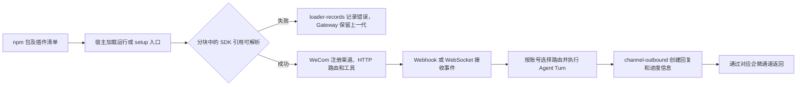

# OpenClaw 2026.11.3 与 2026.11.4 全组件兼容升级

2026-11-16，候选版本 `2026.11.16`，覆盖 27 个 Gateway 插件及共享 message-sdk。安装下限、开发依赖和构建标识统一以 OpenClaw `2026.11.3` 为准。

对应[实施计划](../plans/2026-11-16-openclaw-2026-11-3-upgrade.md)。本轮未修改全局 CLI、个人 Gateway 或服务器上的安装。

## 安装故障及修复

旧版 npm 归档 @partme.ai/wecom@2026.7.1 的分块引用已移除的 channel-message、channel-streaming 及 text-runtime。宿主在解析入口时抛出 ERR_PACKAGE_PATH_NOT_EXPORTED，注册渠道前即退出。Webhook 与 WebSocket 回复管道改用 channel-outbound 的公开导出，超时函数通过 extension-shared 取得，重试函数从 runtime-env 导入。发布检查解析每个归档内的 JavaScript 分块，包括字面量动态 import 和 require，同时核对入口及声明文件。

MQTT 在实际监听端口后明确向宿主报告 `lifecycle: "ready"`。旧的 `running: true` 单独上报会让 2026.11.3 继续显示 starting，Bridge 因此无法选中已上线的监听器。

微信 iLink 使用宿主的账号级配对接口读取授权，保留扫码账号和显式配置的授权，撤销和跨账号回归已通过。企业微信客服的 setup 入口可生成可移植声明，Knowledge 包也已补齐原本声明却漏打包的类型入口。

## 源码与安装态验证

上游参考仓固定为稳定标签 v2026.11.4，提交 `d843d6af39a42cd3c30084edbeabeece732fd93a`，本地所有引用仅有一个可达提交。上游 CodeGraph 索引含 51,603 个文件、996,984 个节点、3,543,912 条关系。迁移依据包括上游 SDK 的公开入口、插件加载器、渠道授权和迁移文档。[上游入口迁移说明](https://github.com/openclaw/openclaw/blob/v2026.11.4/docs/plugins/sdk-migration/import-paths.md)

插件仓同步后的索引含 1,474 个文件、18,855 个节点和 50,263 条关系。宿主的 `recordPluginError` 调用 `resolvePluginImportHint`，用异常及构建元数据生成升级提示；这解释了旧包的 “built with OpenClaw unknown”。渠道入口通过 `defineChannelPluginEntry` 区分运行注册与轻量 setup。微信入站使用 `resolveInboundDirectDmAccessWithRuntime`，其决策读取当前账号的授权名单。上游索引器对 7 处语法给出告警，发布判断另外核对源码、npm exports 和真实安装结果。

| 验证 | 本轮实测结果 |
| --- | --- |
| 依赖与源码 | pnpm 9 生成锁文件，干净目录冻结安装通过。28 个发布组件均通过构建和类型检查。按组件汇总最后一次单测结果为 3,567 项通过，9 项按原测试条件跳过。 |
| 发布脚本和 E2E 工具 | 68 项通过。严格的结构、注释、文档和 README 检查通过。 |
| SDK 运行时契约 | 对两个实际 npm 宿主分别检查 17 个关键函数，两组全部通过。 |
| 最终 npm 归档 | 28 个 tarball 的入口、声明及 SDK 导入检查通过。开发 Node 24.18.0 和与服务器相同的 Node 26.13.1 各在 2026.11.3、2026.11.4 加载全部 28 包的运行、setup 或 SDK 导出入口。 |
| 宿主运行注册 | 使用 Node 26.13.1，分别在两个宿主上对 27 个运行时插件逐个执行 runtime inspect，54 次全部返回 loaded 且版本为 2026.11.16。 |
| Linux 验证 | 官方 Node 26.13.1 Debian 容器中，npm 安装服务器版本 OpenClaw 2026.11.3 与完整 28 包，所有运行、setup 或 SDK 入口均能加载。 |
| 全组件安装态 E2E | 27/27 运行时插件满足仓库的当前证据检查。报告逐一匹配本次宿主、源码和候选归档 SHA-256。三个浏览器渠道另有 Chrome 真实页面测试，MQTT、RabbitMQ、Redis Streams、RocketMQ、Bridge、Router/Gotify、OpenMem 等使用对应的实际本地服务。 |
| 企业微信 | 两版宿主分别安装本地候选并通过 runtime inspect。2026.11.3 隔离网关通过企业微信 AES/SHA1 回调、Agent Turn、进程内及重启后重复消息处理；微信 iLink 和企业微信客服实际安装后的本地平台模拟也已通过。 |

用指定默认账号与另一个测试账号构造多账号配置，两个版本的最终 WeCom 包均选择了指定默认账号。安装态回调用本地模型和平台模拟服务。线上企业账号的凭据、网关和流量未参与验证。

在隔离 Linux 网关上从公开 npm 安装 2026.7.1，复现了服务器同一条缺少 channel-message 的错误，并保留失败的第 3 代安装记录。随后由同一个运行网关安装本地已验归档对应目录，宿主应用第 5 代，随后第 6 代 reload 成功，restartRequired 为 false，运行时列出 wecom 渠道和版本 2026.11.16。

## 发布交接

最终的 28 个 npm 归档和 SHA-512 清单位于本地 `scripts/e2e/reports/release-2026.11.16/`。当前 Git 位于 `feature/REQ-20261116-wandl-openclaw-sdk`，28 个包分别执行 npm publish --dry-run，名称、版本和 SHA-512 全部匹配归档。测试分支为 `test/20261116`。发布使用同一批归档，按依赖顺序推送到公开 npm，再核验 registry 完整性及 latest 标签。

## 首次尝试的历史记录

以下是网络及本地监听受限时的原始诊断。旧版工作区和门禁结果记录该次尝试。

### 当时的契约来源

- 官方 `openclaw/openclaw` 的 `v2026.11.3/package.json`：Git blob `21fc33030bc2e98045b72aca06c3f1d51a9481f6`。
- 官方同一 tag 的 `src/plugin-sdk/channel-outbound.ts`：`f0e6ca8cceeac135fc54ac578074e3222be32b8e`。
- 官方同一 tag 的 `channel-inbound.ts`、`config-mutation.ts`、`runtime-env.ts`、`temp-path.ts` 和 `channels/direct-dm-access.ts`。
- 官方 `openclaw/fs-safe` 的 `v0.26.5/src/file-lock.ts` 和 `src/advanced.ts`；版本与目标宿主 dependencies 一致。
- 本地 `research/openclaw` 版本字段为 2026.11.3，但其 package blob 与 release 不同，只作为辅助源码定位，不冒充发布包。

### 当时的源码变更

- 根包、28 个扩展包和模板的既有开发依赖、peer、install、compat、build 字段迁移到 2026.11.3；插件自身版本保持 2026.7.1。
- wecom 补充 build/compat 元数据；WebSocket、Webhook 和运行时聚合层由 channel-message 改用 channel-outbound；retryAsync 改用 runtime-env。
- douyin 的 waitUntilAbort 改用 channel-outbound。
- wechat 的 typing 改用 channel-outbound；临时目录改用 temp-path；DM 鉴权改用 channel-inbound 已发布的 resolveInboundDirectDmAccessWithRuntime，保留账户与配对名单隔离及授权前短路。
- wechat 配置写入改用 mutateConfigFile，避免从旧快照整体覆盖配置；安全媒体读取与文件锁直接依赖 @openclaw/fs-safe 0.26.5 的公开 API，不导入宿主私有 JS-only 入口。
- 更新 message-sdk 运行时导出检查和 E2E 宿主证据基线；保留历史升级报告。根 README 的运行环境要求同步更新。

文件锁边界：fs-safe 直接锁定沿用宿主锁域、重试次数和过期时间，但无法复用已退出公共 SDK 的宿主 PID/start-time 过期恢复器，因此采用 fail-closed。进程崩溃遗留锁时可能需要对账清理；当前变更未证明其安装态恢复能力。

### 首次执行结果

| 验证 | 结果 | 边界 |
| --- | --- | --- |
| 基线测试先失败再修复 | 已观察 RED/GREEN；9/9 通过 | 验证新版本和 wecom 构建元数据要求 |
| node scripts/check-openclaw-baseline.mjs | 通过 | 配置检查，不是实际宿主版本验证 |
| node scripts/check-release-readiness.mjs | 28 扩展通过 | 不证明可编译、可加载 |
| TypeScript AST 导入审计 | 33 个静态 SDK 子路径，无已移除路径、私有入口或缺失具名导出 | 路径按官方 release exports；具名符号按辅助源码并对关键迁移入口核对 release；不覆盖所有动态导入及类型语义 |
| 修改文件语法与 JSON 解析、git diff --check | 通过 | 不等于 tsc 类型检查 |
| node --test scripts/*.test.mjs | 31/34 通过，3 失败 | 失败明细如下，未忽略或关闭测试 |
| pnpm install --lockfile-only --ignore-scripts … | 失败：ERR_PNPM_META_FETCH_FAIL / ENOTFOUND registry.npmjs.org | pnpm 9.0.0，尚未生成新锁文件 |
| 备用镜像查询 | 失败：ENOTFOUND registry.npmmirror.com | 未更改项目 registry |
| pnpm --filter @partme.ai/wecom typecheck | 失败：tsc: command not found / ENOENT | 项目依赖未安装，不能报告为类型检查通过 |

发布脚本套件失败项均位于 scripts/openmem-protected-e2e.test.mjs：

1. authenticated HTTPS proxy rejects untrusted, anonymous and wrong-token requests：listen EPERM，当前环境禁止监听 127.0.0.1。
2. SIGINT exits nonzero and removes the disposable certificate directory：子进程在预期发送信号前退出，child.kill 返回 false。
3. SIGTERM exits nonzero and removes the disposable certificate directory：同上。子进程 stderr 被既有测试忽略，不能据此断言其全部退出原因。

### 首次执行时待办

- 在可访问 npm 的环境执行 pnpm install，真实生成并提交 pnpm-lock.yaml 的依赖图；**当前锁文件仍为 2026.9.6，不可用手工版本替换冒充生成完成**。
- 安装目标宿主和工具链后运行全仓 build、typecheck、单测、package archive 与 SDK runtime contract 检查。
- 对最终 tarball 执行 wecom 激活与 WebSocket/Webhook、wechat 媒体与鉴权、douyin 生命周期验证，再运行共享 SDK 相关 E2E。
- 在允许 loopback 监听的环境复验 3 个失败脚本测试和相关安全场景。

当前源码为未提交候选变更。用户原有 7 项 Python 缓存删除保持原样。
